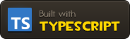
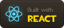
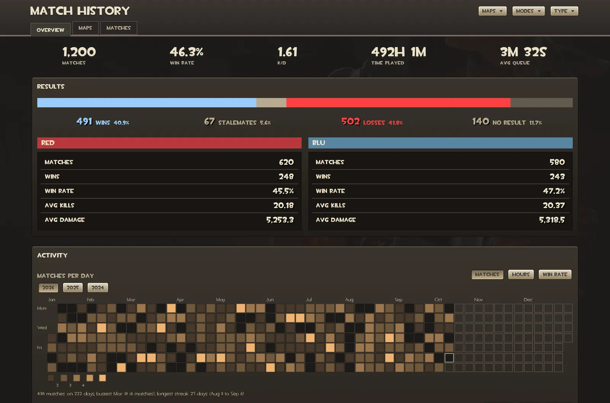

# TF2 Match Data Visualizer

<a href="https://www.typescriptlang.org"></a>
<a href="https://react.dev"></a>
<a href="https://vite.dev"></a>
<a href="https://pnpm.io"></a>

Upload your Team Fortress 2 match history CSV and explore it as stats, charts, and tables, laid out like the game's own menus. Your file is read in your browser and never uploaded anywhere.



## Using it

- **Load:** use the file picker, drop a CSV anywhere on the page, or paste CSV text. The file never leaves your browser.
- **Getting your data:** the in-app help ("How do I get my data?") walks through it. Open the Steam match history page, copy the script, paste it into the browser console, and wait for the CSV to download.
- **Overview:** HUD numbers for matches, win rate, K/D, time played, and average queue, with results, an activity calendar, a weekday by hour heatmap, monthly form and per-match trends, game modes, classes, queue times, and records.
- **Maps:** your maps ranked by how often you played them, with a chart you can rank by matches or hours and a table of map details.
- **Matches:** a scoreboard of every match, searchable and sortable, with an "All columns" view for every CSV column, formatted. "View" links from the Overview tab open the match here.
- **Filters:** the Maps, Modes, and Type dropdowns in the header apply to every tab. Click an item to cycle it through off, include, and exclude.
- **Tooltips:** hover a number or header to see how it is computed.

## Running it

```sh
pnpm install
pnpm dev       # http://127.0.0.1:5173
pnpm build     # type-check and build to dist/
pnpm preview   # serve the built dist/
```

Inside a pnpm workspace, add `--ignore-workspace` to each command so pnpm uses this project's own lockfile. Every push to `main` builds the site and deploys it to GitHub Pages. Project layout and conventions are in [docs/development.md](docs/development.md); the tab components are in [docs/components.md](docs/components.md), the Overview tab in [docs/overview.md](docs/overview.md), the match data contract in [docs/data.md](docs/data.md), the map data refresh in [docs/map-data.md](docs/map-data.md), and the badges in [docs/badges.md](docs/badges.md).

## Credits

Unofficial fan tool, not affiliated with Valve. The Team Fortress 2 fonts, textures, glyphs, class icons, menu backgrounds, and character art are Valve's, extracted from the game files in `tf2_textures_dir.vpk`: `materials/vgui/glyph_*.vtf`, `materials/hud/leaderboard_class_*.vtf`, `materials/hud/ico_camera.vtf`, `materials/console/characters/*.vtf`, `materials/console/background_*.vtf`, and the title images. The button click sound is `sound/ui/buttonclick.wav` from `tf2_sound_misc_dir.vpk`. Map names come from TF2's `items_game.txt` and the [TF2 Wiki](https://wiki.teamfortress.com). The CSV icon is drawn for this site in the style of the game glyphs. The README badges follow [Devin's Badges](https://github.com/intergrav/devins-badges), with icons from [Simple Icons](https://simpleicons.org).

## License

The code is [MIT](LICENSE). It doesn't cover the TF2 assets above, which belong to Valve.
